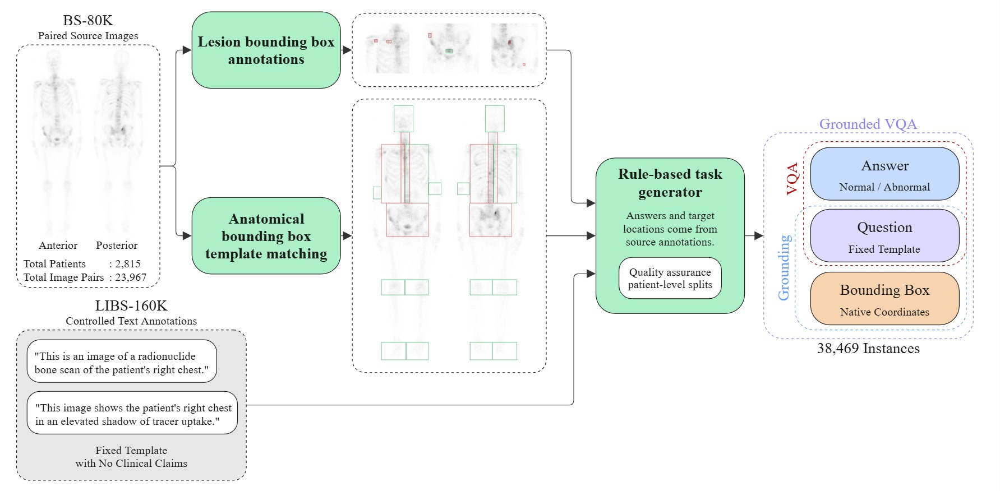
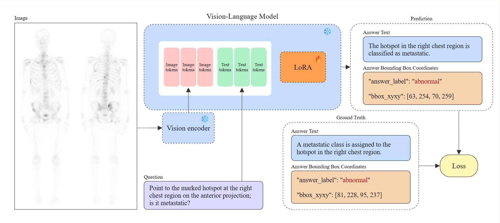
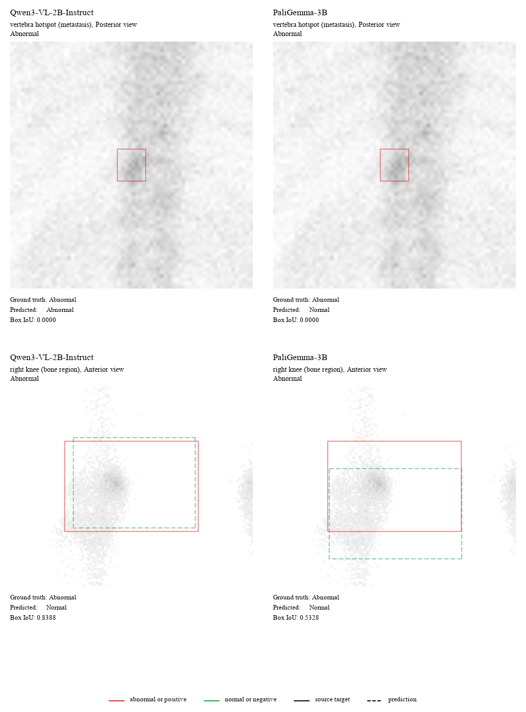

# wbbs-vlm-experiment

Code, configurations, and evaluation scripts for ScintiGround-38K, a grounded visual question answering benchmark for paired anterior and posterior whole-body bone scintigraphy. This repository is part of that research: it builds the benchmark from BS-80K annotations and fixed rule-based question templates, fine-tunes two vision-language models on it, and scores them. The manuscript is under review.

## The benchmark

ScintiGround-38K has 38,469 instances. One instance is one question or request about one target in one patient's paired anterior and posterior images, with the outputs it requires. All boxes and answers derive from BS-80K annotations (a malignant hotspot makes its bone region abnormal, and an abnormal bone region makes the whole-body view abnormal; the source region label is kept next to the label used), question wording comes from fixed rule-based English templates, and the LIBS-160K caption sentences are kept as provenance text. The instances are a 15% sample of the task rows of the full release (seed `wbbs-r3-compact-v1`) with forced coverage of every referenced image. The derived annotations are published on Zenodo ([10.5281/zenodo.23887845](https://doi.org/10.5281/zenodo.23887845)).

| Task | Required output | Train | Validation | Test | Total |
| --- | --- | ---: | ---: | ---: | ---: |
| VQA | yes or no answer | 10,726 | 1,340 | 1,305 | 13,371 |
| Image localization | one or two boxes | 10,068 | 1,256 | 1,225 | 12,549 |
| Grounded VQA | answer and one or two boxes | 10,068 | 1,257 | 1,224 | 12,549 |
| Total | | 30,862 | 3,853 | 3,754 | 38,469 |

The instances come from 54,768 source records (51,803 normal, 2,965 abnormal) and 23,967 anterior and posterior image pairs from 2,815 patients. Patients are split 80%, 10%, and 10%, and every record of a patient stays in one split.



## Baselines

Qwen3-VL-2B-Instruct and PaliGemma-3B-pt-224 were fine-tuned with LoRA (4-bit NF4, rank 8, alpha 16, learning rate 5e-5, effective batch size 8, seed 5070, two epochs) on the same multitask training set. The epoch with the best validation score was kept, and the locked test split was evaluated after that choice. Qwen3-VL receives the two images natively; PaliGemma receives them composed into one canvas.



## Results

Test split. Accuracy is high because 94.6% of the source labels are normal; balanced accuracy and abnormal-class F1 show how little of the minority class the models recover.

| Model | Task | Accuracy | Balanced accuracy | Macro-F1 |
| --- | --- | ---: | ---: | ---: |
| Qwen3-VL-2B-Instruct | VQA | 0.886 | 0.528 | 0.529 |
| PaliGemma-3B-pt-224 | VQA | 0.888 | 0.535 | 0.541 |
| Qwen3-VL-2B-Instruct | Grounded VQA | 0.906 | 0.539 | 0.550 |
| PaliGemma-3B-pt-224 | Grounded VQA | 0.908 | 0.524 | 0.524 |

| Model | Task | Mean IoU | Box accuracy (IoU at least 0.50) | Strict localization accuracy | Valid responses |
| --- | --- | ---: | ---: | ---: | ---: |
| Qwen3-VL-2B-Instruct | Image localization | 0.642 | 0.857 | 0.827 | 0.998 |
| PaliGemma-3B-pt-224 | Image localization | 0.633 | 0.787 | 0.762 | 1.000 |
| Qwen3-VL-2B-Instruct | Grounded VQA | 0.640 | 0.843 | 0.765 | 0.999 |
| PaliGemma-3B-pt-224 | Grounded VQA | 0.629 | 0.776 | 0.701 | 1.000 |

| Model | Task | Normal precision | Normal recall | Normal F1 | Abnormal precision | Abnormal recall | Abnormal F1 |
| --- | --- | ---: | ---: | ---: | ---: | ---: | ---: |
| Qwen3-VL-2B-Instruct | VQA | 0.897 | 0.985 | 0.939 | 0.357 | 0.071 | 0.118 |
| PaliGemma-3B-pt-224 | VQA | 0.899 | 0.985 | 0.940 | 0.414 | 0.085 | 0.141 |
| Qwen3-VL-2B-Instruct | Grounded VQA | 0.913 | 0.991 | 0.951 | 0.526 | 0.087 | 0.149 |
| PaliGemma-3B-pt-224 | Grounded VQA | 0.910 | 0.996 | 0.951 | 0.600 | 0.052 | 0.096 |



PaliGemma's patient-cluster bootstrap 95% intervals (2,000 resamples, 281 test patients): VQA balanced accuracy 0.511 to 0.561, localization IoU at 0.5 0.755 to 0.815, grounded VQA strict accuracy 0.666 to 0.734. The two models differ in image input, so the table does not rank model families.

Predicting the locked test split again with the same Qwen3-VL adapter, without retraining, changes the headline metrics by up to 0.025, because batched greedy decoding depends on batch size and hardware:

| Run | VQA balanced accuracy | Localization IoU at 0.5 | Strict grounded accuracy |
| --- | ---: | ---: | ---: |
| Reported | 0.5277 | 0.8567 | 0.7647 |
| RTX 5070 Ti, second prediction set | 0.5518 | 0.8697 | 0.7884 |
| RTX 4050, batch 8 | 0.5384 | 0.8521 | 0.7639 |

## Repository layout

| Path | Contents |
| --- | --- |
| `src/preprocess` | source import, quality checks, pairing, and the task builders |
| `src/training` | LoRA fine-tuning and prediction for Qwen3-VL and PaliGemma |
| `src/postprocess` | model output parsers and training exports |
| `src/metric` | VQA, grounding, and text metrics, patient-cluster bootstrap |
| `src/analysis` | dataset audits, comparison with other datasets, image-free baselines |
| `configs` | dataset policies and experiment configurations (`configs/registry.md` lists them) |
| `scripts` | launchers, dataset rebuild, locked-test scoring, model comparison |
| `tests` | unit tests |

## Intervals, controls, and the blank-image test

Patient-cluster bootstrap 95% intervals (2,000 resamples, seed 20260722, 281 test patients) for the answer and localization summaries, with two controls that never see the image: the majority answer, and a naive Bayes classifier over the question tokens that predicts the median training box of the named region. Balanced accuracy equals the hard-label AUC because each model gives one label per question.

| System | VQA balanced accuracy | Grounded VQA balanced accuracy | Image localization box accuracy on bone regions (IoU at least 0.50) | Image localization box accuracy on hotspots (IoU at least 0.50) |
| --- | ---: | ---: | ---: | ---: |
| Qwen3-VL-2B-Instruct | 0.528 (0.503 to 0.556) | 0.539 (0.509 to 0.578) | 0.958 (0.942 to 0.972) | 0.030 (0.007 to 0.057) |
| PaliGemma-3B-pt-224 | 0.535 (0.511 to 0.561) | 0.524 (0.503 to 0.556) | 0.877 (0.852 to 0.901) | 0.048 (0.019 to 0.083) |
| Question-only control | 0.676 (0.632 to 0.716) | 0.666 (0.602 to 0.726) | 0.140 (0.119 to 0.164) | 0 |
| Majority-class control | 0.500 | 0.500 | 0.049 (0.035 to 0.065) | 0 |

The two models do not differ on answers (Holm-adjusted p = 1.0). Qwen3-VL places boxes more accurately in grounded VQA (box accuracy higher by 0.067, 95% interval 0.043 to 0.093, Holm p = 0.008). Three prediction runs of the same Qwen3-VL adapter on the test split differ by 0.024 in VQA balanced accuracy, which is three times the difference between the two models. Both models locate bone regions (whose boxes come from template matching) but not hotspots, whose median box is 12 by 10 pixels. With every validation image replaced by a black image, bone-region box accuracy falls from 0.970 to 0.202 (Qwen3-VL) and from 0.896 to 0.260 (PaliGemma-3B), while VQA balanced accuracy changes by 0.031 and 0.028.

```powershell
uv run python scripts/compute_r3_statistics.py
uv run python scripts/compute_r3_supplementary.py
.\scripts\run_blind_image_check.ps1
```

## Score-based AUC

The generated labels give one operating point of the ROC curve, so their balanced accuracy is the hard-label AUC. `training/score.py` gives each VQA and grounded VQA instance a score instead. For every answer sentence of the training split (6 to 12 per class and region level) it computes the probability that the adapter assigns to the output up to the class value, sums the probabilities by class, and takes the log-odds of the positive class (yes or abnormal). The images and the prompt are encoded once per instance and the candidates run as one batch against a copy of the cache. `analysis/score_auc.py` computes the AUC with the patient-cluster intervals of the other tables, over all instances and within each region level, and the paired differences; the question-only control is scored by the log-odds of its classifier.

| System | VQA AUC | Grounded VQA AUC |
| --- | ---: | ---: |
| Qwen3-VL-2B-Instruct | 0.788 (0.743 to 0.828) | 0.768 (0.698 to 0.828) |
| PaliGemma-3B-pt-224 | 0.814 (0.765 to 0.858) | 0.790 (0.711 to 0.854) |
| Question-only control | 0.768 (0.723 to 0.810) | 0.712 (0.630 to 0.779) |
| Qwen3-VL-2B-Instruct, black images | 0.784 (0.739 to 0.822) | 0.756 (0.679 to 0.819) |
| PaliGemma-3B-pt-224, black images | 0.785 (0.745 to 0.822) | 0.768 (0.706 to 0.821) |

Both models are above the control (Holm p from 0.002 to 0.037), the two models do not differ, and replacing every scan by a black image changes no AUC significantly after Holm correction.

```powershell
uv run --no-sync python -m training.score --config configs/score_auc_261102.json --model qwen3vl --split validation --limit 64
uv run --no-sync python -m training.score --config configs/score_auc_261102.json --model qwen3vl --split test
uv run --no-sync python -m training.score --config configs/score_auc_261102.json --model paligemma --split test_blind
uv run --no-sync python -m analysis.score_auc --config configs/score_auc_261102.json
```

`scripts/run_queue.py` runs such stages one after another, with a log, a state file and an ETA, and resumes after an interruption (`configs/queue_261102.json`).

## Reproduce

The code expects a project folder with `datasets/` and `results/weights/` next to `repositories/` (set `WBBS_PROJECT_ROOT` to use another location). The images and model weights are not in this repository. The derived annotations are on Zenodo ([10.5281/zenodo.23887845](https://doi.org/10.5281/zenodo.23887845)).

```powershell
uv sync --extra training --extra dev --extra analysis --extra eval
uv run python scripts/regenerate_dataset.py
.\scripts\run_qwen3_r3_multitask_2epoch_fast.ps1 -Preflight -Profile 5070
.\scripts\run_paligemma_multitask.ps1
uv run python scripts/score_locked_test.py --expected <multitask_test.jsonl> --predictions <predictions.jsonl> --metrics-output <metrics.json> --bootstrap-output <bootstrap.json>
```

`regenerate_dataset.py` rebuilds the benchmark from the BS-80K and LIBS-160K sources and compares every file with the frozen release. The training launchers do not touch the locked test split unless asked.

## Adapters and predictions

The [v1.1.0 release](https://github.com/Liamours/wbbs-vlm-experiment/releases/tag/v1.1.0) holds the two LoRA adapters that validation selected (`qwen3vl-r3-adapter.zip`, epoch 1, and `paligemma-r3-adapter.zip`, epoch 2), the predictions behind the reported tables (`reported-predictions.zip`, test and validation split of each model), and `SHA256SUMS.txt`. The [v1.2.0 release](https://github.com/Liamours/wbbs-vlm-experiment/releases/tag/v1.2.0) holds the outputs behind the score-based AUC (`analysis-outputs.zip`: scores of both adapters with real and black images, the question-only control scores, AUC and ROC tables, black-image validation predictions, two further Qwen3-VL test predictions, and the statistics tables). Each adapter follows the terms of its base model: Apache License 2.0 for Qwen3-VL-2B-Instruct and the Gemma Terms of Use for PaliGemma-3B-pt-224. The base models are not included.

## Data

| Source | Terms |
| --- | --- |
| BS-80K (Huang et al., Comput Biol Med 151:106221, 2022) | no license stated; images are not redistributed |
| LIBS-160K (Wei, figshare, DOI 10.6084/m9.figshare.28715375) | CC BY 4.0 |
| ScintiGround-38K annotations (this work, Zenodo) | CC BY 4.0 |

For research use only, not for clinical decisions. The code is released under the MIT license (see `LICENSE`); the annotations are CC BY 4.0. See `CONTRIBUTING.md` for annotation corrections.

## Citation

Cite the dataset record ([10.5281/zenodo.23887845](https://doi.org/10.5281/zenodo.23887845)); CITATION.cff has the entry.
